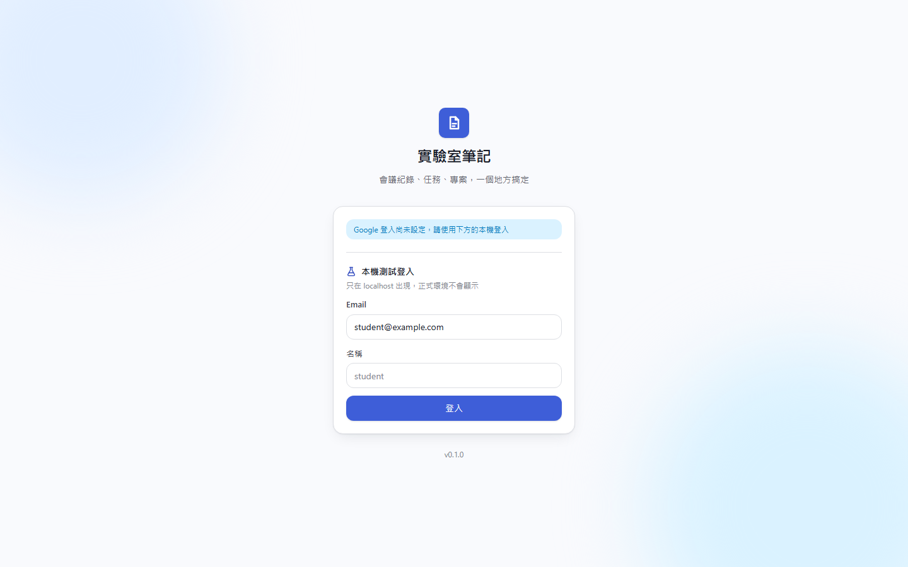
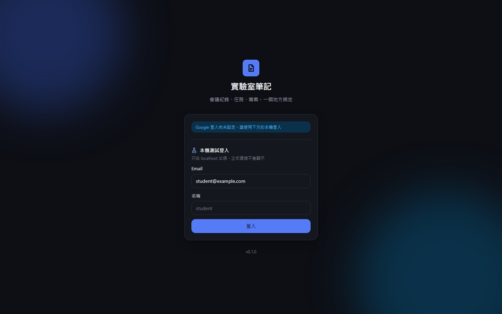
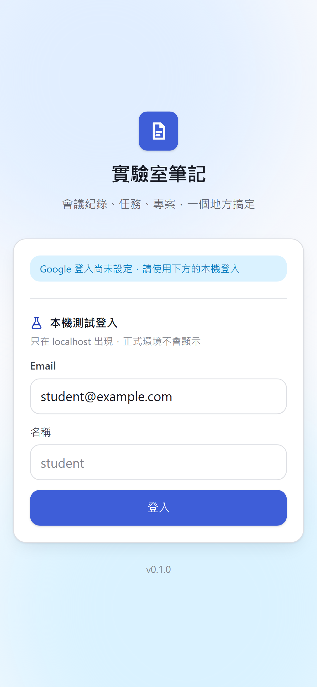
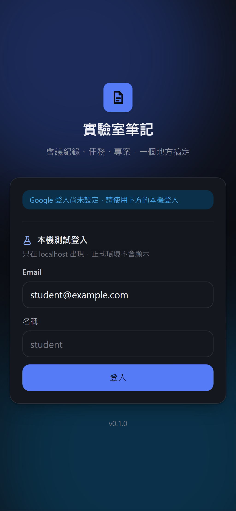
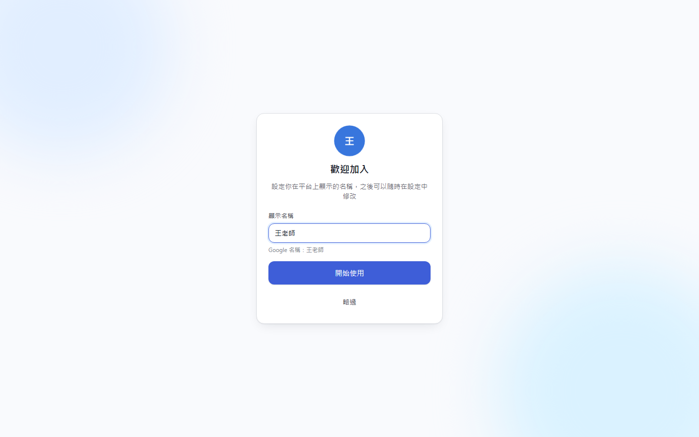
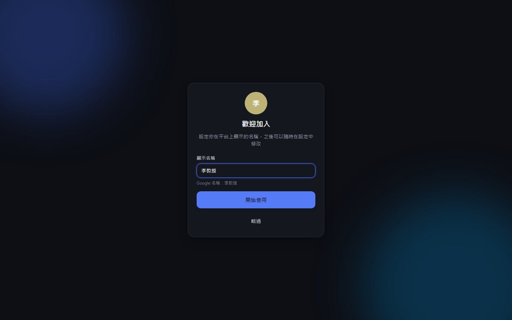
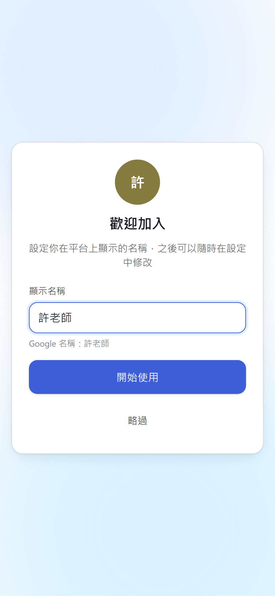
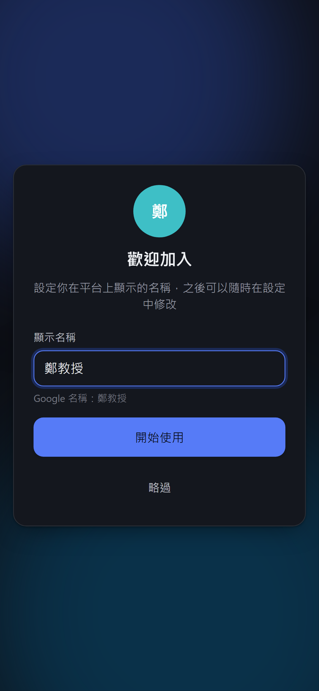

# [MS-5] 用 Google 帳號登入並設定名稱

> 狀態：進行中

## 內文

### 需求
使用者用 Google 帳號登入；第一次登入可以設定在平台上顯示的名稱，不設定就用 Google 的名稱。

### 來源
使用者 2026-10-19 對話（初始需求）；設計：`design/02-architecture.md` §3；決策：任何 Google 帳號都能登入

### 驗收條件
- [x] 未登入造訪任何頁面會導到登入頁，登入後回到原本要去的頁面
- [ ] 登入頁只有一個「使用 Google 登入」按鈕，不需要另外註冊
- [x] 第一次登入後出現設定名稱頁，預填 Google 名稱與頭像；按「略過」直接用 Google 名稱
- [x] 再次登入不會再出現設定名稱頁
- [ ] 使用者在 Google 同意畫面按取消，回到登入頁並顯示「已取消登入」，不出現錯誤頁
- [x] 被停用或移除的帳號登入時顯示「此帳號已被停用，請聯絡管理員」
- [x] 登入流程防 CSRF 與重放（state 與 PKCE 驗證失敗時拒絕並記 log）

### 測試流程
1. 用從沒登入過的 Google 帳號登入，看到設定名稱頁，改名後進入首頁，右上角顯示新名稱
2. 登出後再登入，直接進首頁
3. 另一個新帳號登入時按「略過」，顯示 Google 名稱
4. 在 Google 同意畫面按取消，回到登入頁看到提示

---

# 跟其他票的關係

- Blocks：MS-6、MS-7、MS-8、MS-11
- Blocked by：MS-1
- Related：無

---

# Commit-1

## 內文

原本沒有登入。
現在支援 Google OAuth（Authorization Code + PKCE，驗證 id_token），任何 Google 帳號都能登入，第一次登入會到設定名稱頁並預填 Google 名稱，略過就用 Google 名稱，之後登入不再出現。被停用的帳號會看到停用提示。state 或 PKCE 不符時拒絕並記 log。另外在 localhost 提供「本機測試登入」，沒有 Google 金鑰也能完整測試，正式環境不會出現。
尚未驗證：實際 Google 帳號登入與「在 Google 按取消」的流程（需要 Google OAuth Client ID）。

### 測試結果

| 項目 | 結果 |
|---|---|
| 整合測試：未登入 API 回 401 與統一錯誤格式 | 通過 |
| 整合測試：新帳號為學生、老師 Email 為老師 | 通過 |
| E2E 登入 → 設定名稱 → 首頁 | 通過（四種組合） |

### 截圖

**登入頁（本機測試登入）**

**第一次登入設定名稱**

