# [MS-60] 降低專案管理操作延遲

> 狀態：完成

## 內文

### 需求
專案管理介面操作時延遲感很重：打開專案、點進議題、改狀態、新增議題都要等好幾秒或卡一下。要讓常用操作感覺即時：點了就有畫面，伺服器回應在背景補上；第二次打開專案（包括重新整理後）要直接顯示上次看到的內容，不必每次都等資料庫讀完。

### 來源
使用者 2026-11-24 對話：「專案管理介面使用起來延遲感非常嚴重」「看能不能加入正確使用 cache 讓打開專案管理的時候載入可以更快，而不是每次都要重新從 SQL 讀取」

### 驗收條件
- [x] 伺服器每次查詢資料庫的時間大幅縮短，回應帶有可觀察的資料庫耗時
- [x] 從列表點進議題時立刻顯示標題與欄位，詳細內容隨後補上
- [x] 改狀態、指派等欄位立刻反映在畫面上，失敗時還原並提示
- [x] 建立議題後對話框立刻關閉，完成時提示並可一鍵開啟；失敗時保留草稿可重新開啟
- [x] 打開過的專案在重新整理後立刻顯示上次的列表，同時向伺服器取最新資料
- [x] 登出或換帳號後，瀏覽器裡的快取資料全部清除

### 測試流程
1. 打開一個專案，點一筆議題，再回列表
2. 在議題頁改狀態，確認立即變更
3. 按 c 建立議題，確認對話框立刻關閉並出現「已建立」提示，按「開啟」前往該議題
4. 重新整理專案頁（伺服器故意變慢），列表仍立刻出現
5. 登出後確認瀏覽器快取已清空

---

# 跟其他票的關係

- Blocks：無
- Blocked by：無
- Related：MS-61

---

# Commit-1

## 內文

延遲的主因是伺服器位置：台灣的請求進到新加坡機房，資料庫卻在東京，每查一次資料庫就要來回約 120 毫秒，打開一個專案要查十幾次。現在伺服器固定在東京旁執行，正式站每次查詢降到約 7–16 毫秒；每個回應都附上資料庫耗時與查詢次數，之後變慢可以直接看出原因。打開專案、議題時的查詢也合併、改成同時進行。
畫面這邊：游標停在議題上就先載入，點進去立刻顯示列表裡已有的標題與欄位；改狀態、指派等欄位立刻生效，失敗才還原並提示；建立議題後對話框立刻關閉，背景送出完成時提示「已建立」並可按「開啟」，失敗時草稿保留、可一鍵重開。
打開過的專案管理資料會存在使用者自己的瀏覽器（IndexedDB），重新整理或隔天再開都先顯示上次的內容，同時向伺服器取最新的；只存自己看得到的資料，登出或換帳號就清空，網站更新版本或超過 3 天也會丟棄。寫入只在專案資料變動、瀏覽器閒置時進行，不影響捲動與打字。
以模擬的 120 毫秒查詢延遲量測：重新整理後打開專案 5.9 秒 → 1.8 秒（有快取時立即顯示）、打開議題 2.0 秒 → 0.27 秒、改狀態 1.1 秒 → 立即、建立議題對話框 22 毫秒內關閉。

### 測試結果

| 項目 | 結果 |
|---|---|
| 完整測試套件（vitest） | 通過 58 / 58 |
| E2E 全套（四種組合） | 通過 130 / 130（14 項依版面略過）；4 線並行 7 分鐘，並行時 4 項受計時或其他測試資料干擾，單獨重跑全數通過 |
| E2E 建立議題立即關閉、改狀態立即生效（四種組合） | 通過 4 / 4 |
| E2E 瀏覽器快取：伺服器延遲 3 秒仍立即顯示、登出後清空（四種組合） | 通過 4 / 4 |
| 型別檢查 | 0 錯誤 |
| Lint、色碼、對比度檢查 | 通過 |

### 截圖

**建立議題後立刻關閉並提示**

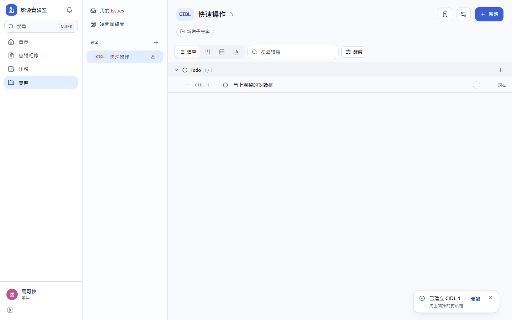
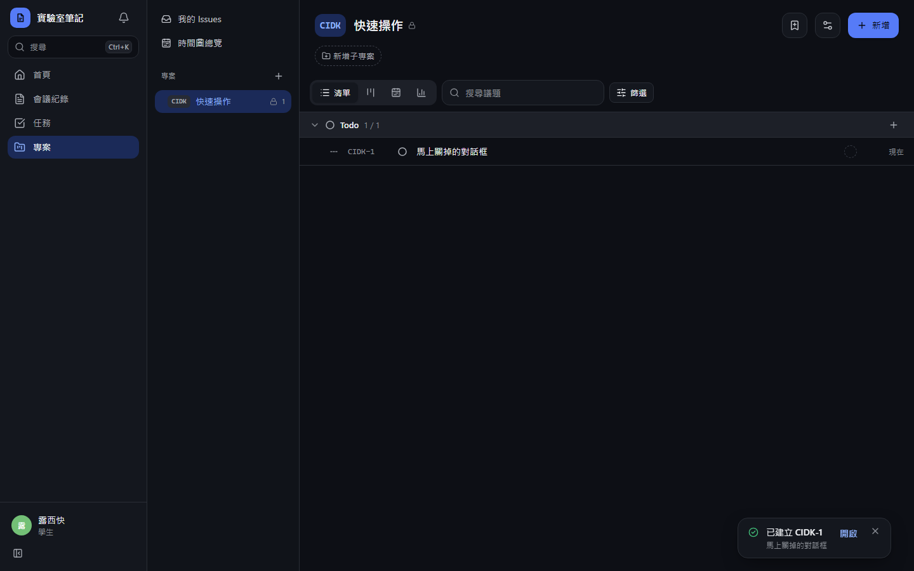
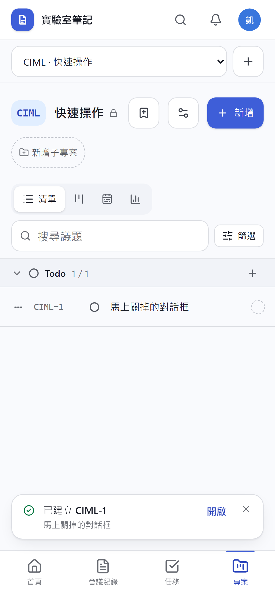
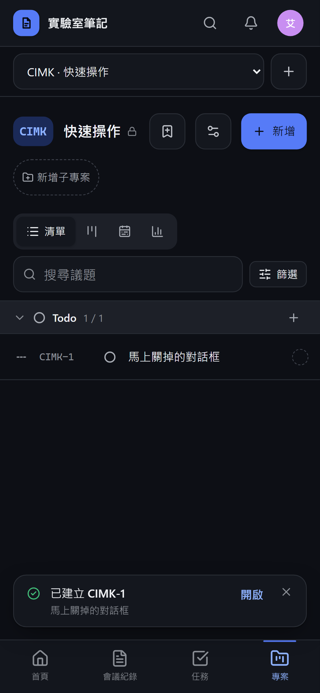

**議題頁改狀態立即生效**

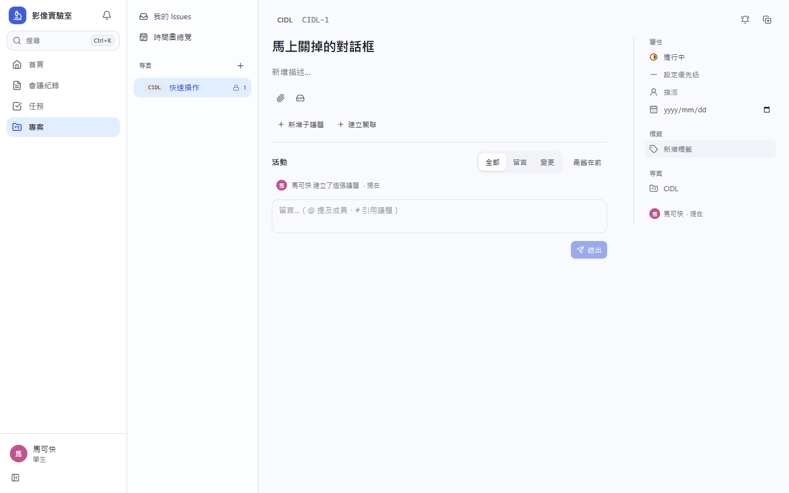
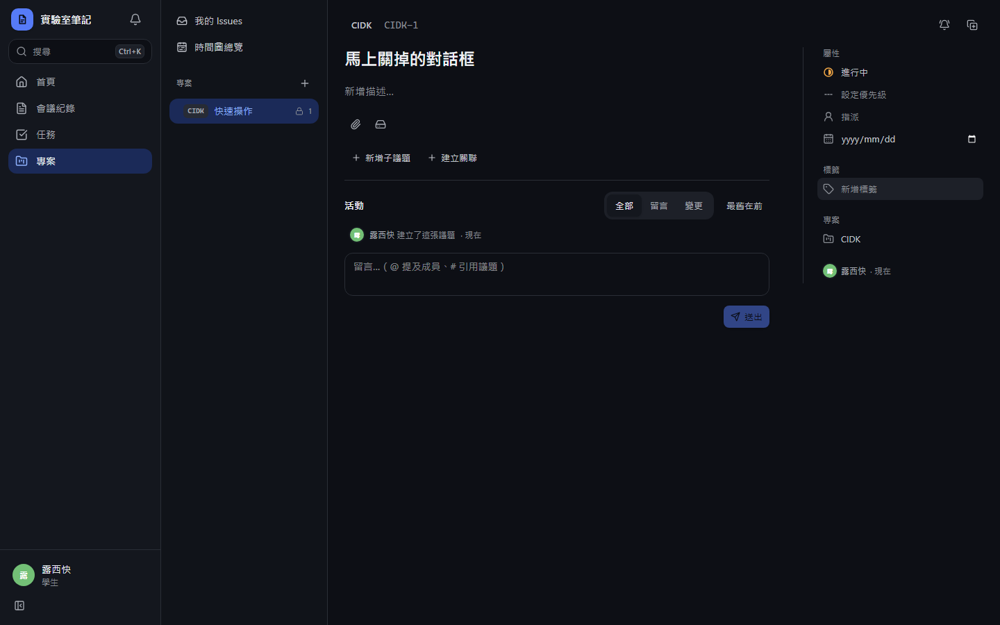
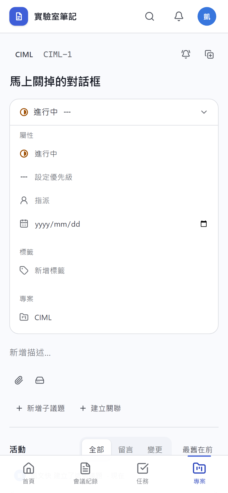
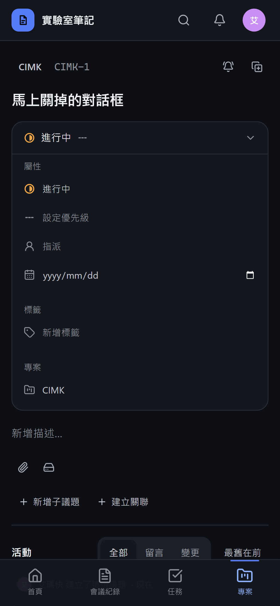

**伺服器變慢時，重新整理仍立刻顯示上次的列表**

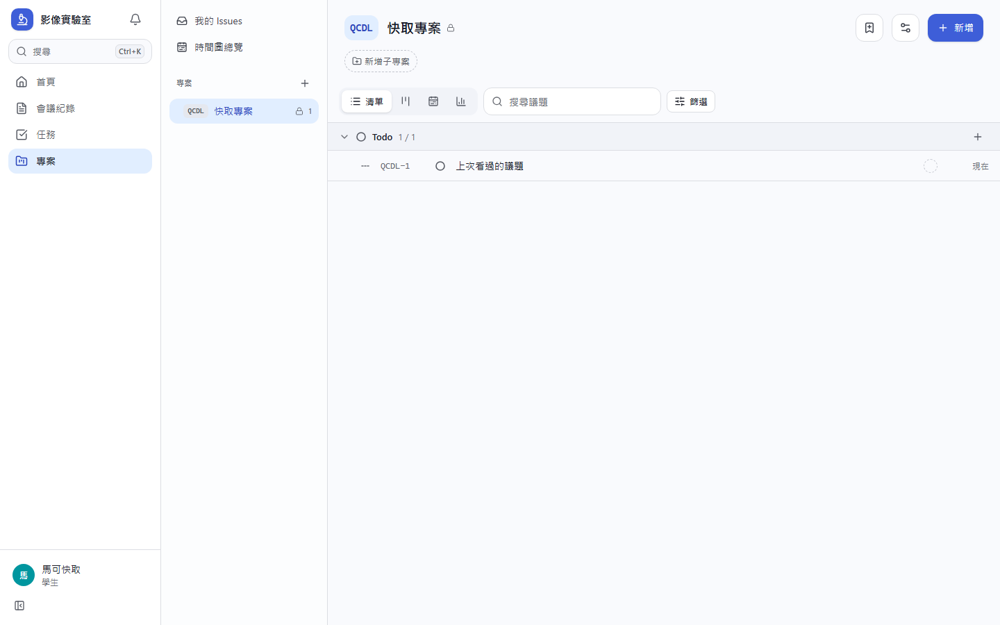
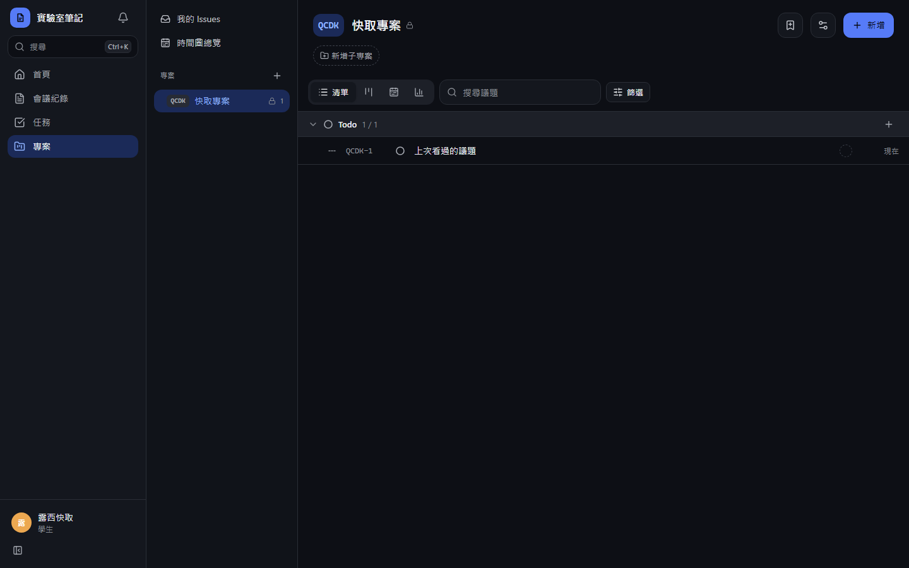
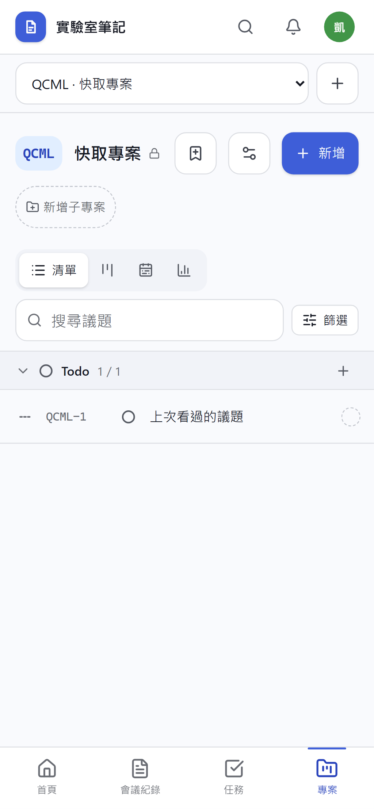
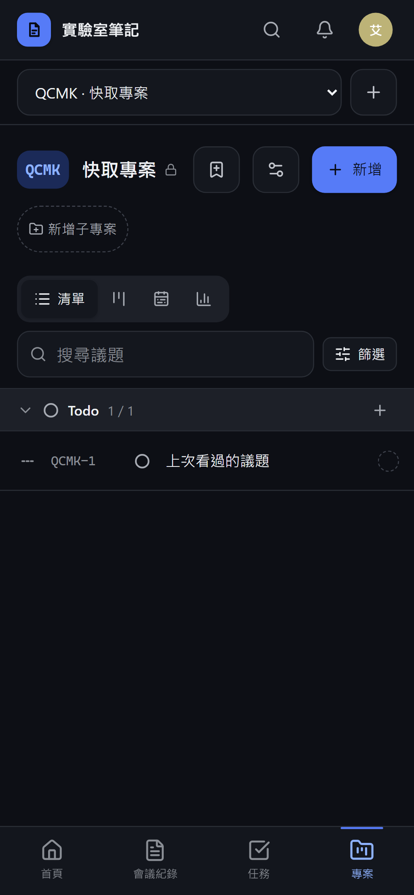

---
