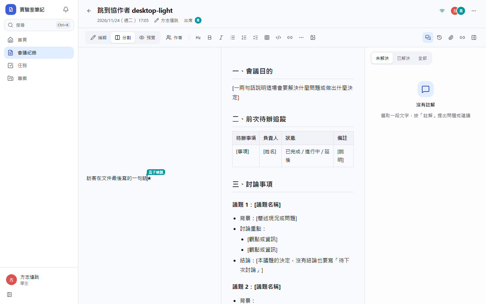
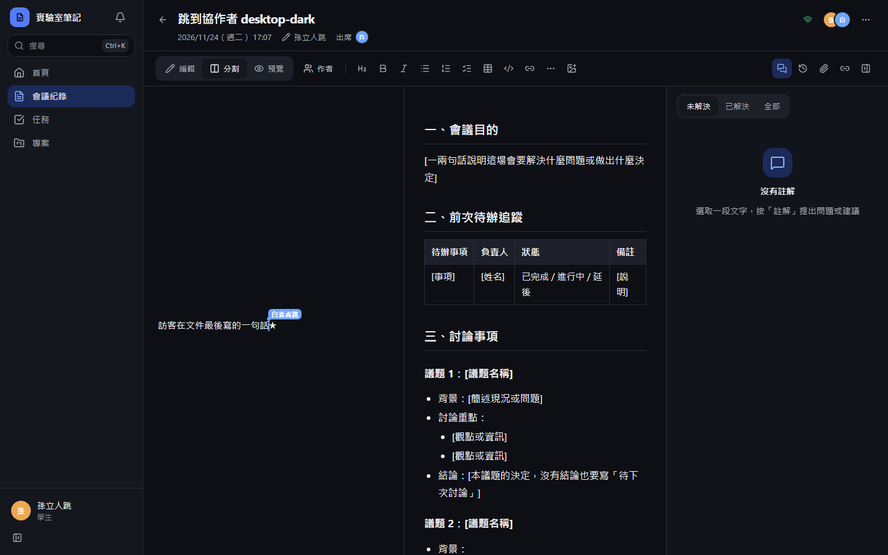

# [MS-61] 改善共同編輯會議紀錄體驗

> 狀態：完成

## 內文

### 需求
共同編輯會議紀錄時，打開紀錄要等連線、狀態偶爾一直顯示「離線中」，也不知道其他人正在文件哪裡編輯。要讓打開紀錄更快、連線狀態正確，並能直接跳到協作者正在編輯的位置。

### 來源
使用者 2026-11-24 對話：「共同編輯會議紀錄的地方也幫我看看有沒有甚麼地方也可以提升使用者體驗」

### 驗收條件
- [x] 從列表打開會議紀錄比原本更快（滑鼠停在卡片上就先載入）
- [x] 打開紀錄時同步連線與載入內容，不再先等內容才連線
- [x] 快速離開又回到同一份紀錄時，連線狀態正確，不會卡在「離線中」
- [x] 在線人數按鈕列出協作者，選一位就把游標移到對方正在編輯的位置並可直接輸入
- [x] 協作者還沒放游標時，給出提示而不是沒反應

### 測試流程
1. A、B 同時打開同一份紀錄
2. B 在文件最下方輸入一句話
3. A 按「人在線」選 B，畫面捲到 B 的那一行，A 直接輸入的字出現在那一行
4. A 離開紀錄再立刻回來，狀態顯示已連線

---

# 跟其他票的關係

- Blocks：無
- Blocked by：無
- Related：MS-12、MS-60

---

# Commit-1

## 內文

打開會議紀錄原本要等內容載入完才開始連線共同編輯，現在兩者同時進行；在列表把游標停在卡片上就先載入內容，從列表打開由 0.92 秒降到 0.39 秒。
連線狀態改成直接讀取連線本身，快速離開又回到同一份紀錄時不再卡在「離線中」。
標題列的在線頭像變成選單，列出正在編輯的協作者，選一位就把畫面捲到對方游標所在行、游標移過去，可以直接接著打字；對方還沒點進文件時會提示，而不是沒有反應。手機版標題列沒有在線名單，這項只在電腦版。

### 測試結果

| 項目 | 結果 |
|---|---|
| 完整測試套件（vitest） | 通過 58 / 58 |
| E2E 全套（四種組合） | 通過 130 / 130（14 項依版面略過）；4 線並行 7 分鐘，並行時 4 項受計時或其他測試資料干擾，單獨重跑全數通過 |
| E2E 跳到協作者位置（電腦淺色、深色） | 通過 2 / 2 |
| 型別檢查 | 0 錯誤 |
| Lint、色碼、對比度檢查 | 通過 |

### 截圖

**選協作者後跳到對方的位置並直接輸入**

---
