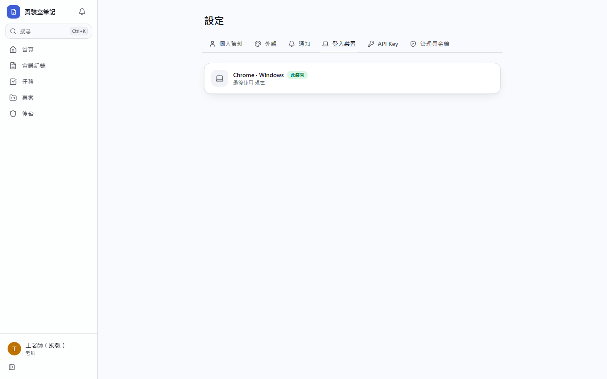
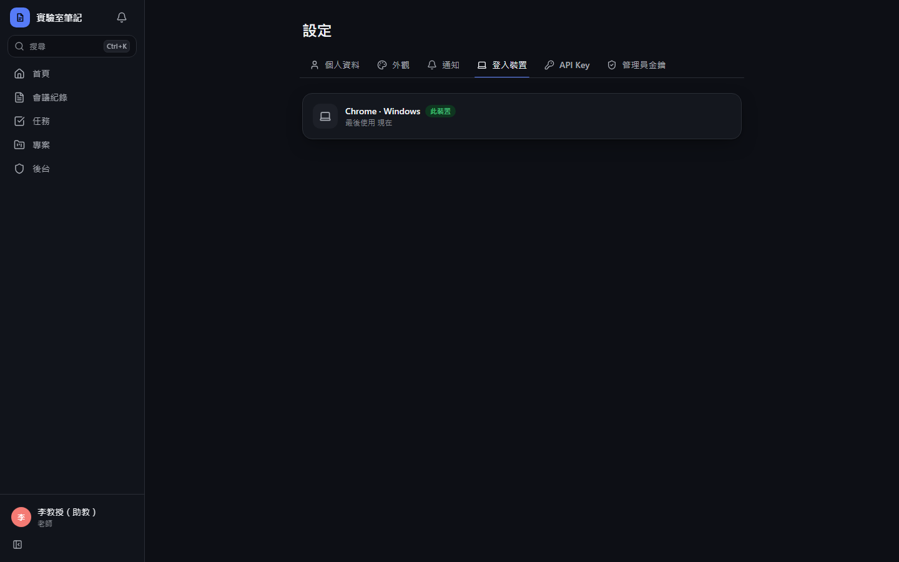
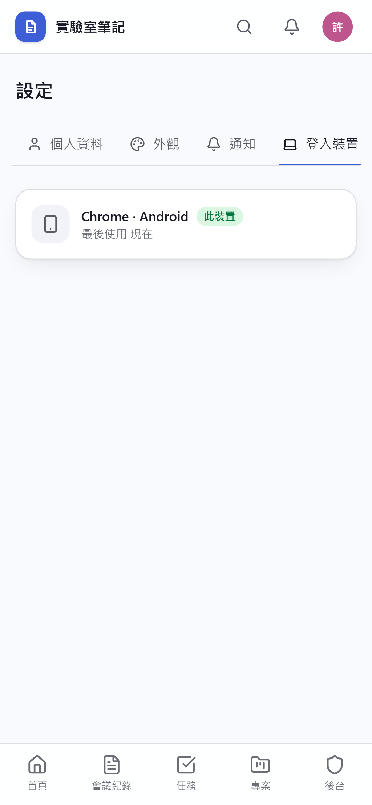
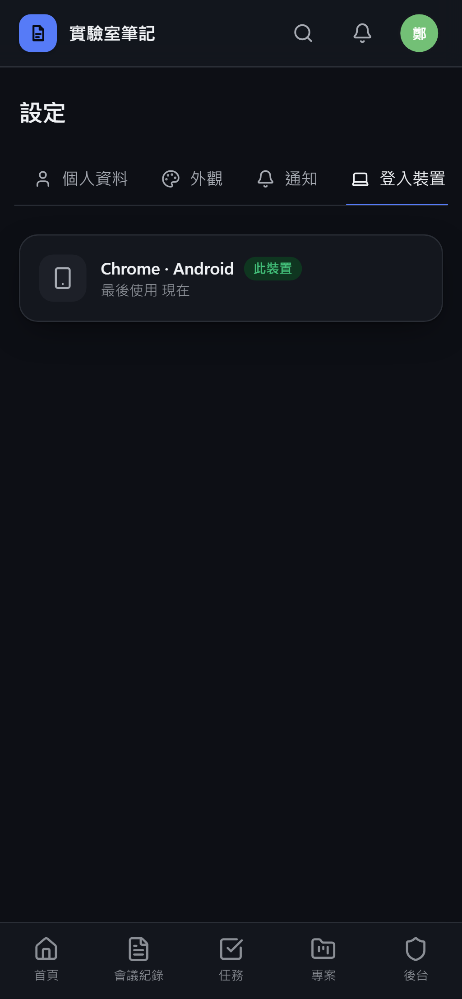
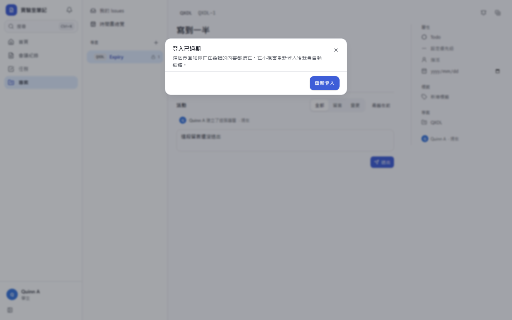
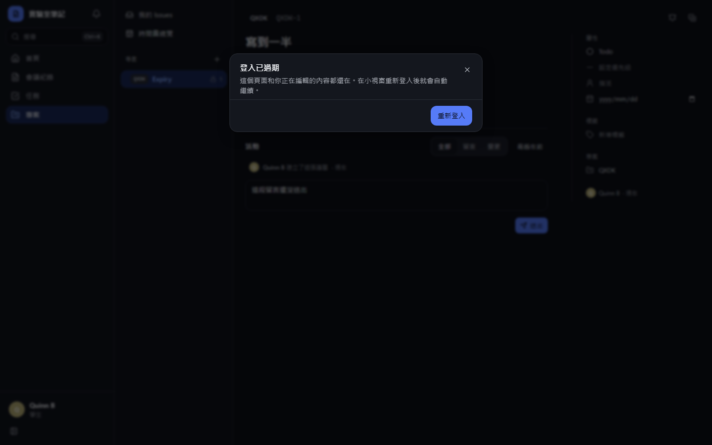
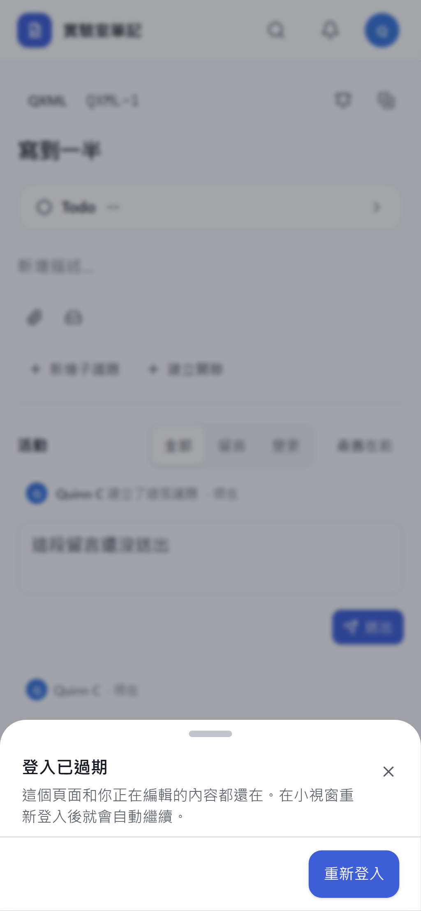
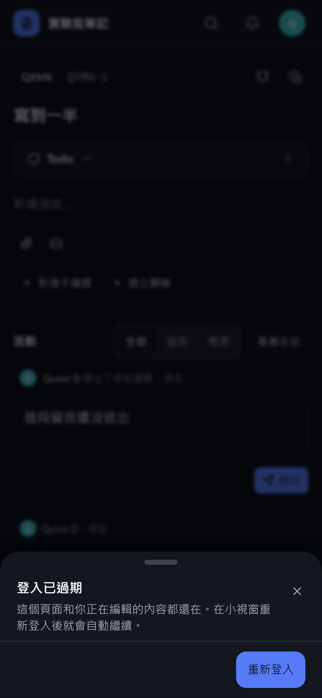

# [MS-6] 保持登入並記住上次帳號

> 狀態：進行中

## 內文

### 需求
不要每次來網站都要重新登入；就算憑證過期必須重新登入，也預設用上次的帳號，不用每次重選。

### 來源
使用者 2026-10-19 對話（初始需求）；設計：`design/02-architecture.md` §3

### 驗收條件
- [x] 登入後 30 天內再來不用重新登入；期間每天第一次使用會自動延長
- [ ] 關閉瀏覽器、重開手機、PWA 重新開啟都維持登入
- [ ] session 過期後按「使用 Google 登入」，Google 直接以上次的帳號登入，不出現帳號選擇畫面（同一瀏覽器已登入該 Google 帳號時）
- [x] 登入頁顯示「以 xxx@gmail.com 繼續」與「使用其他帳號」兩個選項
- [x] 登出會清除本機 session，且下一次預設帳號仍是上次的帳號（另有「忘記此帳號」）
- [x] 設定頁列出目前所有登入中的裝置，可登出單一裝置或全部
- [x] 使用者在操作中 session 過期時，未存的內容不會遺失，重新登入後回到原畫面

### 測試流程
1. 登入後關閉瀏覽器，隔天重開，直接進入首頁
2. 在資料庫把 session 改成已過期，重新整理，看到「以 xxx 繼續」，按下後不需選帳號即登入
3. 在設定頁登出另一台裝置，該裝置下一次請求即被導到登入頁
4. 編輯議題描述時讓 session 過期，按儲存後重新登入，描述內容還在

---

# 跟其他票的關係

- Blocks：無
- Blocked by：MS-5
- Related：無

---

# Commit-1

## 內文

原本沒有 session。
現在登入後發一個 30 天的 HttpOnly cookie，每天第一次使用自動延長；資料庫只存雜湊。登入時另記住上次的 Email，重新登入會帶 login_hint，Google 直接用該帳號；登入頁顯示「以 xxx 繼續」與「使用其他帳號」，登出後仍記得上次帳號（可選擇忘記）。設定頁列出所有登入中的裝置，可登出單一或其他全部裝置。
尚未驗證：實機關閉瀏覽器與 PWA 重開、Google 實際略過帳號選擇畫面、操作中 session 過期時保留未存內容。

### 測試結果

| 項目 | 結果 |
|---|---|
| E2E 登入裝置清單 | 通過（四種組合） |
| 整合測試：停用帳號後 session 立即失效 | 通過 |

### 截圖

**登入裝置**

# Commit-2

## 內文

原本操作到一半 session 過期時，送出會失敗，只能重新整理頁面登入，正在寫的內容可能遺失。
現在 session 過期會跳出「登入已過期」對話框，按「重新登入」在小視窗完成登入，小視窗自動關閉後原頁面照常使用，正在寫的留言還在，再按送出即可成功；不會另外跳出重複的錯誤提示。瀏覽器擋下彈出視窗時改在原分頁登入並回到原頁面。
驗收：寫留言途中把 session 登出後按送出，出現對話框；在小視窗登入後，留言框內容仍是原文字，送出成功。

### 測試結果

| 項目 | 結果 |
|---|---|
| 完整測試套件（vitest） | 通過 46 / 46 |
| E2E（Playwright，4 種裝置×主題） | 通過 92 / 92（4 項僅桌機，手機略過） |
| 型別檢查 | 0 錯誤 |
| lint（含色碼與對比度檢查） | 0 錯誤 |

### 截圖

**登入過期對話框**

