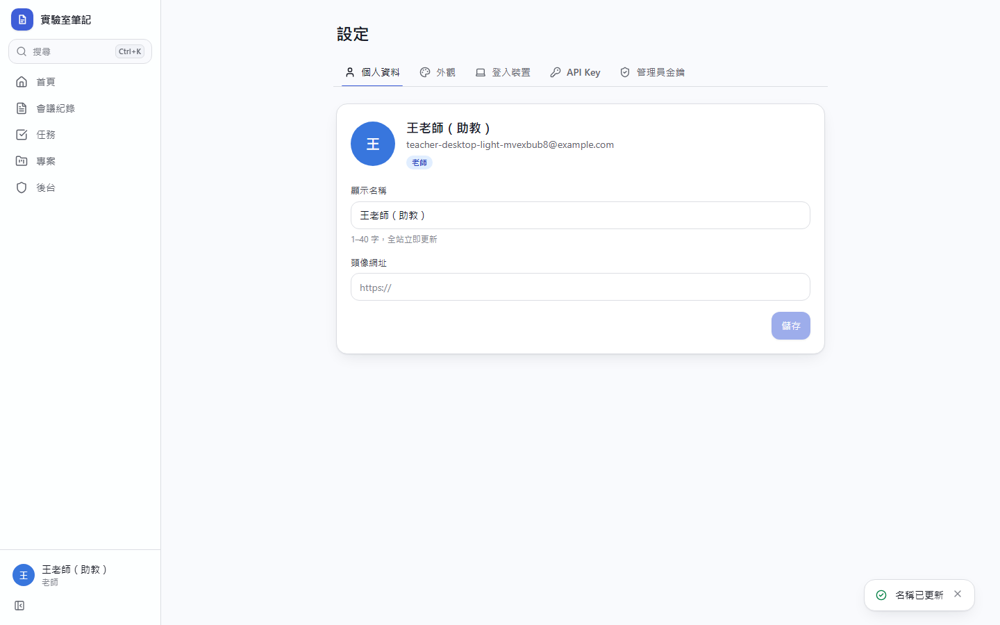
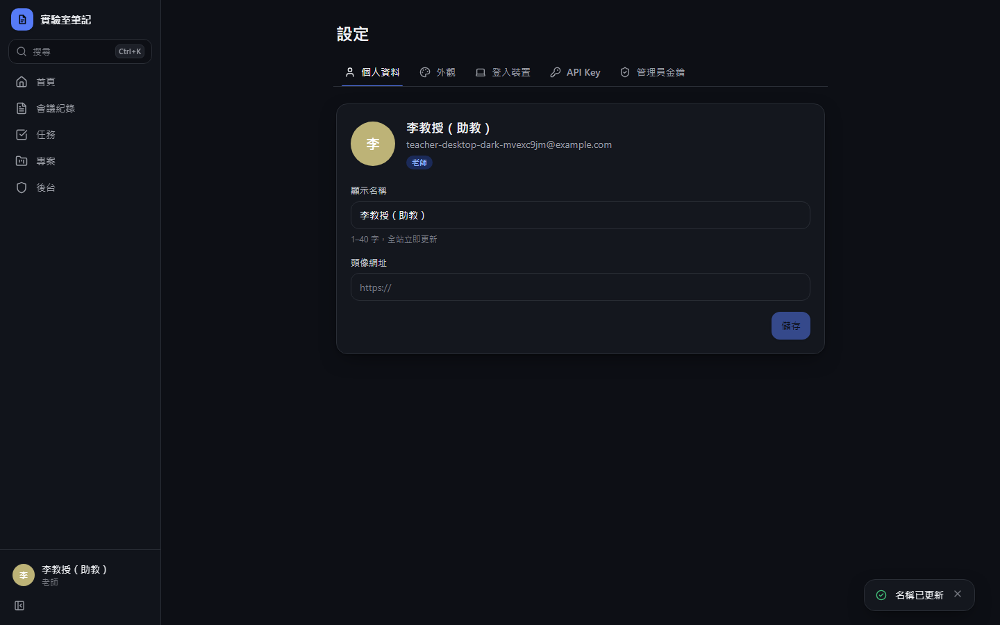
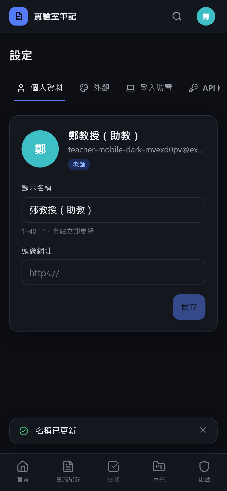

# [MS-7] 讓使用者隨時修改顯示名稱

> 狀態：完成

## 內文

### 需求
使用者可以隨時改名稱，改完之後全站所有地方（包含舊的會議紀錄、留言、活動紀錄、作者標示）都要立刻顯示新名稱。

### 來源
使用者 2026-10-19 對話（初始需求）

### 驗收條件
- [x] 設定頁可修改名稱與頭像（上傳或用 Google 頭像），名稱 1–40 字，前後空白自動去除
- [x] 改名後不重新整理，目前畫面上所有出現此人的地方立刻更新
- [x] 其他人的畫面在下一次載入或 1 分鐘內更新為新名稱
- [x] 過去的活動紀錄、留言、註解、@提及、作者標示、排行榜都顯示新名稱
- [x] 活動紀錄記一筆「改名：舊 → 新」，管理員後台查得到

### 測試流程
1. A 在會議紀錄寫一段、在議題留言、被 @ 一次
2. A 改名
3. A 自己畫面上的頭像選單、留言、作者標示立刻變新名稱
4. B 重新整理後在同樣位置看到新名稱，@提及 pill 也是新名稱

---

# 跟其他票的關係

- Blocks：無
- Blocked by：MS-5
- Related：無

---

# Commit-1

## 內文

原本沒有顯示名稱的概念。
現在設定頁可改名稱與頭像網址，所有紀錄只存帳號 id，畫面上一律即時查目前名稱，所以改名後自己的畫面立刻更新，其他人在下次載入或 60 秒內更新；舊的會議紀錄、註解、作者標示、活動紀錄都顯示新名稱。改名會記一筆活動「從舊名改成新名」。
驗收：改名後活動流顯示新名稱與改名紀錄。

### 測試結果

| 項目 | 結果 |
|---|---|
| 整合測試：改名後成員目錄立即是新名稱 | 通過 |
| E2E 改名與活動紀錄 | 通過（四種組合） |

### 截圖

**改名成功**

**活動流中的改名紀錄**

