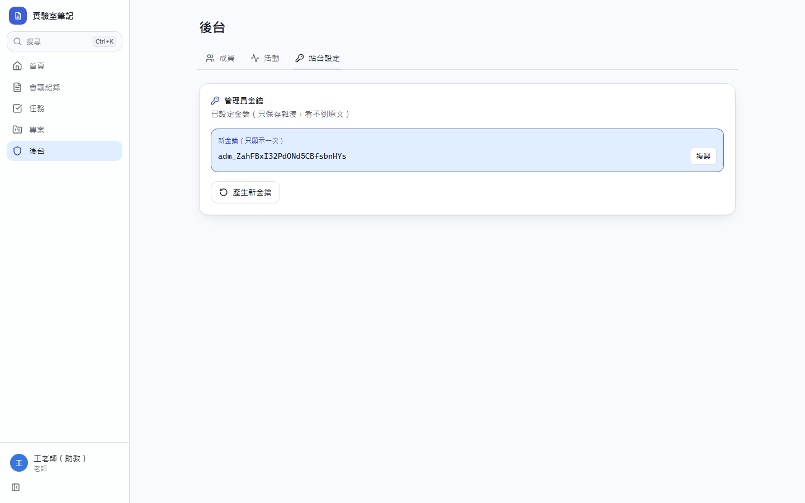
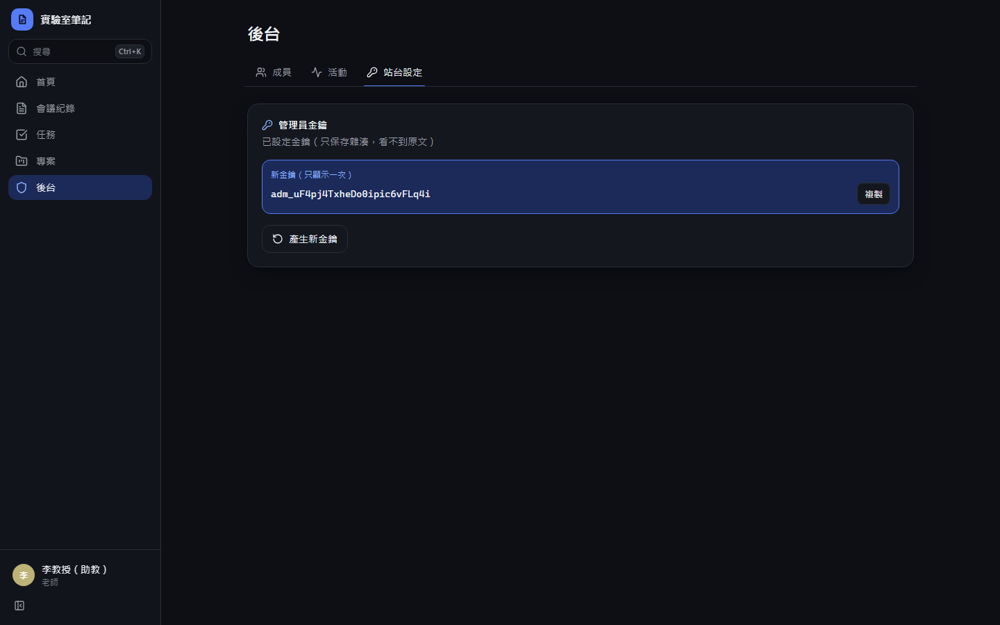
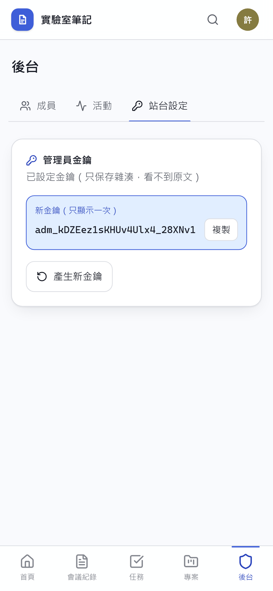
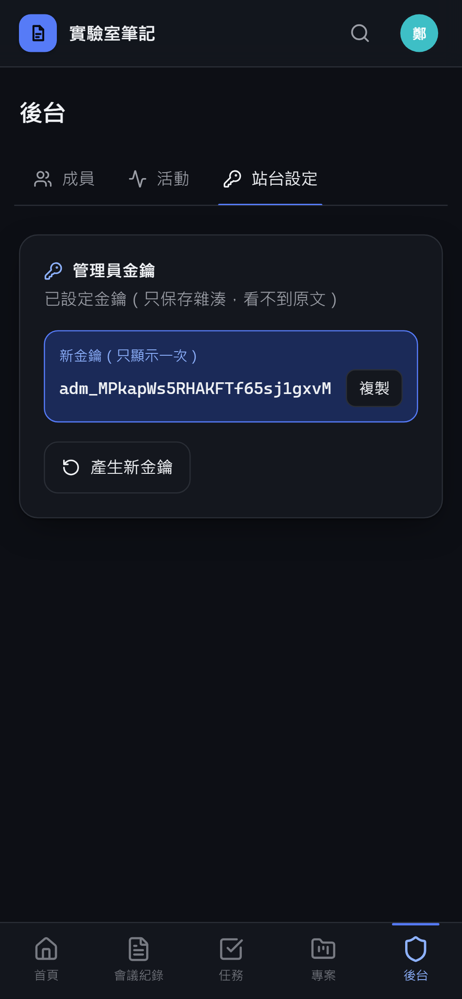
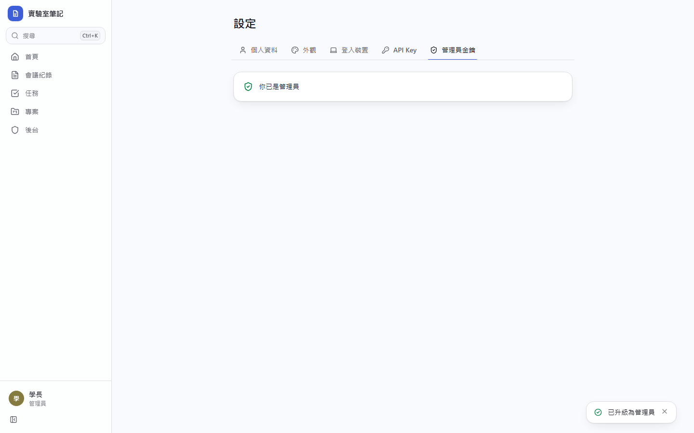
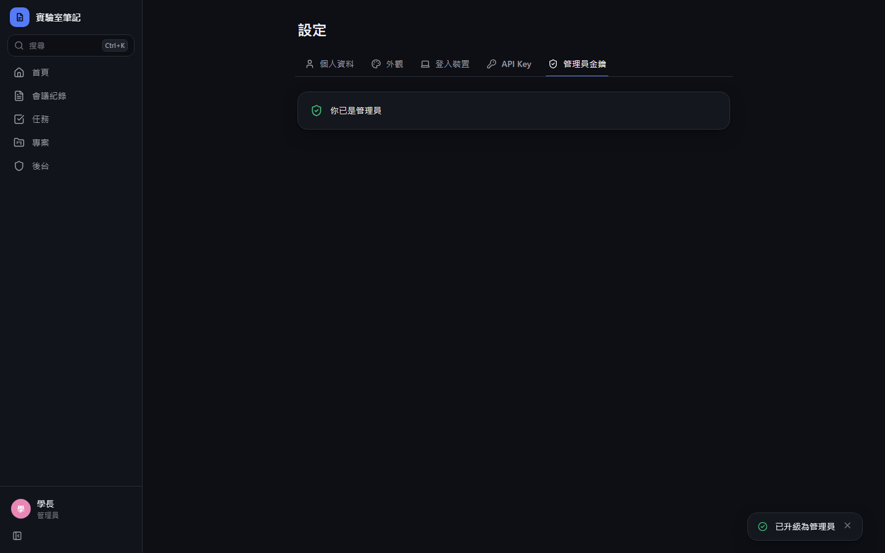
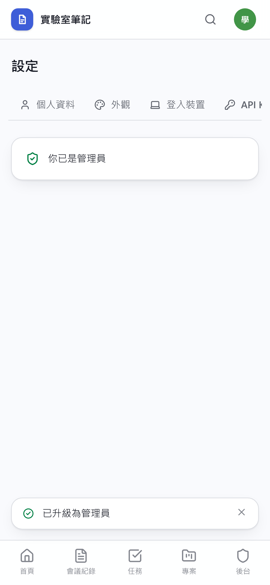
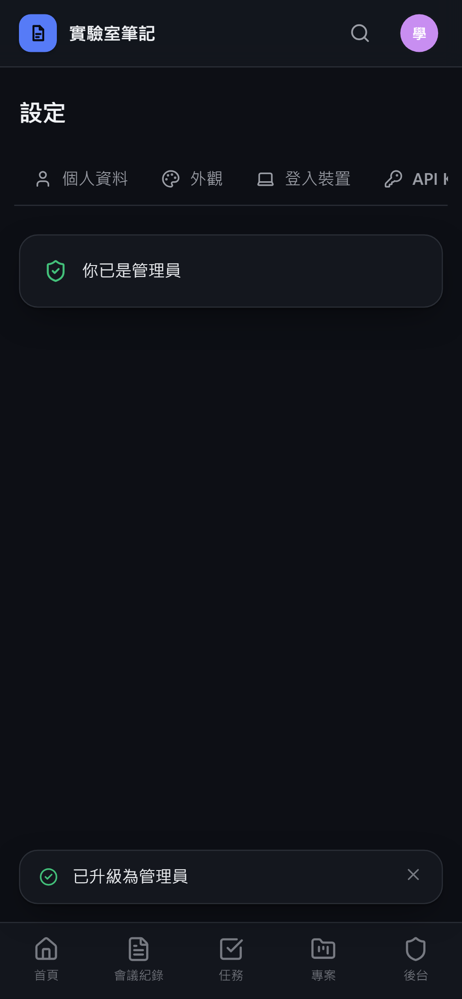

# [MS-8] 建立站台角色與管理員金鑰

> 狀態：完成

## 內文

### 需求
所有人登入時都是學生；老師可以把成員設成管理員（學長），成員也可以輸入管理員金鑰自動升級成管理員。

### 來源
使用者 2026-10-19 對話（初始需求）；設計：`design/01-product.md` §2.1；待確認 #2

### 驗收條件
- [x] 新帳號預設為學生
- [x] 部署設定中的老師 Email 登入後自動是老師
- [x] 設定頁有「輸入管理員金鑰」，輸入正確即升級為管理員並看到後台入口；輸入錯誤顯示「金鑰不正確」，連續錯誤 5 次鎖 15 分鐘
- [x] 老師可在後台輪替管理員金鑰，舊金鑰立即失效
- [x] 伺服器端每個需要權限的動作都檢查角色；學生直接呼叫管理員 API 回 404
- [x] 角色變更立即生效，不需重新登入
- [x] 最後一位老師不能被降級或移除
- [x] 每次角色變更都記活動：誰把誰從什麼改成什麼、透過什麼方式（指定或金鑰）

### 測試流程
1. 學生帳號登入，看不到後台入口；直接打後台網址看到找不到頁面
2. 輸入錯誤金鑰 5 次，第 6 次顯示鎖定提示
3. 輸入正確金鑰，升級成管理員，後台入口出現
4. 老師輪替金鑰，用舊金鑰升級另一個帳號失敗
5. 老師嘗試把自己（唯一老師）降級，被拒絕並顯示原因

---

# 跟其他票的關係

- Blocks：MS-10、MS-21、MS-26、MS-43、MS-45
- Blocked by：MS-5
- Related：無

---

# Commit-1

## 內文

原本沒有角色。
現在有學生、管理員、老師三種站台角色：新帳號是學生，部署設定的 Email 自動是老師。老師可在後台產生管理員金鑰（只顯示一次、舊的立即失效），學生在設定頁輸入就升級為管理員，連錯 5 次鎖 15 分鐘。學生打管理員 API 一律回 404。角色變更不需重新登入，最後一位老師不能被降級，每次變更都記活動並標示是「指定」還是「金鑰」。

### 測試結果

| 項目 | 結果 |
|---|---|
| 整合測試：金鑰錯 5 次鎖定、輪替、正確金鑰升級 | 通過 |
| 整合測試：學生打後台 API 回 404 | 通過 |
| 整合測試：最後一位老師不能降級 | 通過 |
| E2E 產生金鑰 → 學長輸入升級 | 通過（四種組合） |

### 截圖

**老師產生管理員金鑰**

**學長輸入金鑰升級成功**

