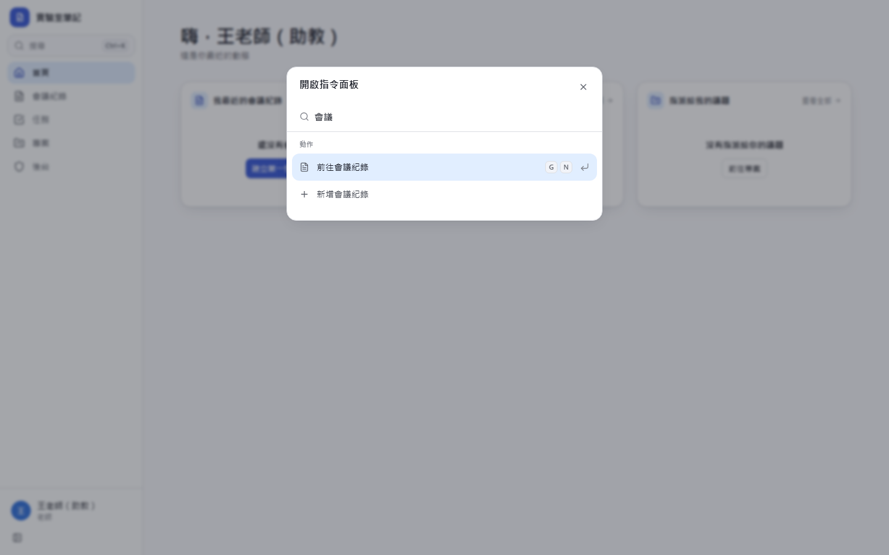
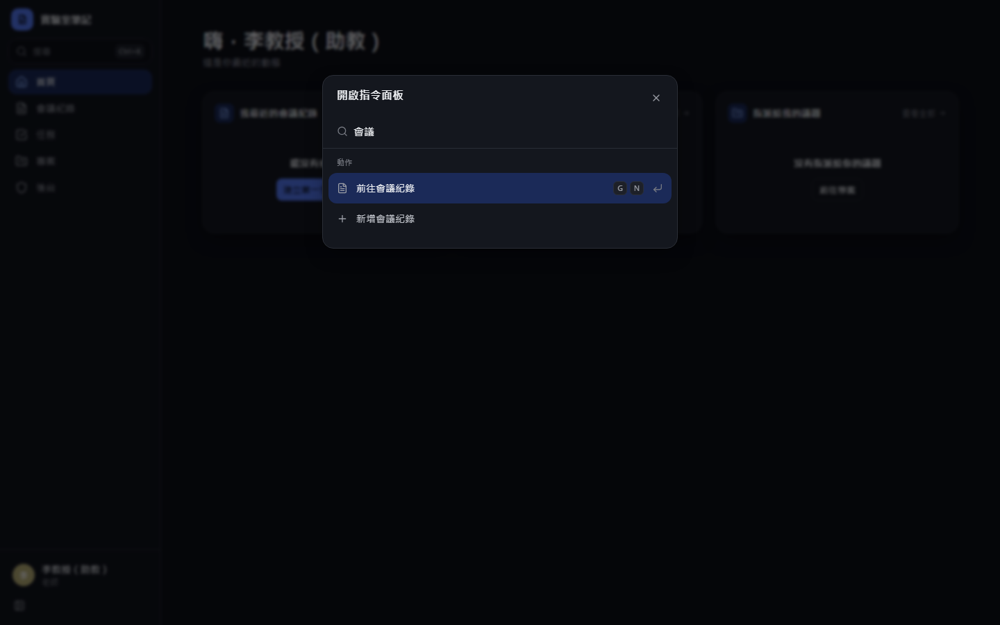
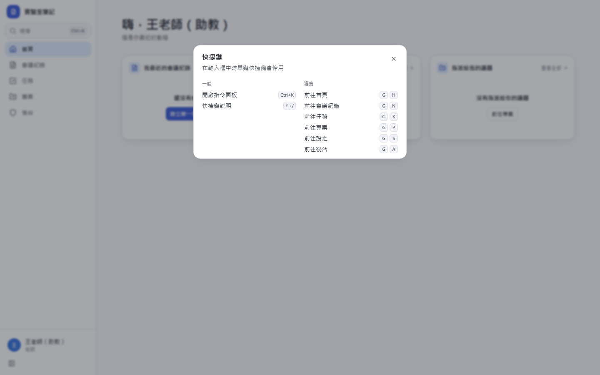
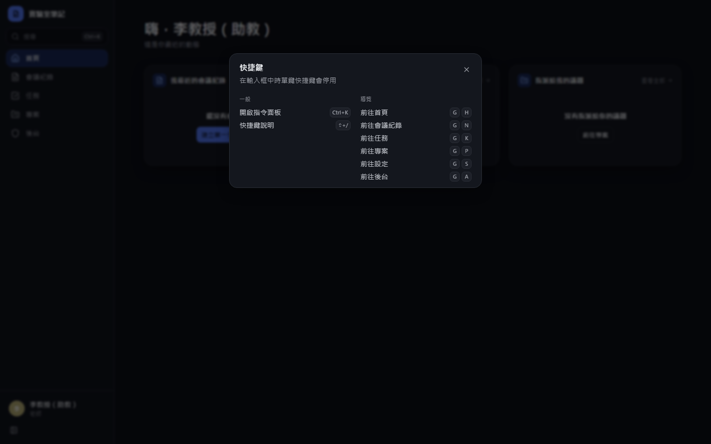

# [MS-9] 統一快捷鍵、右鍵選單與指令面板

> 狀態：進行中

## 內文

### 需求
每個動作只定義一次，快捷鍵、右鍵選單、指令面板（⌘K）、快捷鍵說明（?）、tooltip 角標都從同一份清單產生，永遠一致。

### 來源
使用者 2026-10-19 對話（初始需求）；設計：`design/05-project-management.md` §6

### 驗收條件
- [x] ⌘K／Ctrl+K 開指令面板：上半部搜尋動作，下半部搜尋會議紀錄、任務、議題（可打 `KEY-12`）
- [x] ? 開快捷鍵說明，列出的按鍵都是當下可用的
- [x] 對話框開著時按 C 不會再開一個（範圍堆疊）；輸入框有焦點時單鍵快捷鍵停用
- [x] Esc 逐層關閉，只關最上層浮層
- [ ] 右鍵選單、tooltip 角標與快捷鍵說明的按鍵文字一致，Mac 顯示 ⌘、Windows 顯示 Ctrl
- [ ] 手機上沒有快捷鍵，指令面板從頂端搜尋按鈕開啟，右鍵選單改長按
- [ ] §6 快捷鍵表全部可用（各模組的動作在該模組的票驗收）

### 測試流程
1. 按 ⌘K，搜尋「主題」，選擇後執行切換主題
2. 打開開票視窗後按 C，不會出現第二個視窗
3. 在確認框上按 Esc，只關確認框，下層視窗與草稿還在
4. 按 ? 檢查列出的快捷鍵，逐一試按皆有效
5. 手機長按清單項目，出現與電腦右鍵相同的選單

---

# 跟其他票的關係

- Blocks：MS-10、MS-29、MS-30
- Blocked by：MS-2
- Related：無

---

# Commit-1

## 內文

原本沒有快捷鍵。
現在所有動作來自同一份動作清單：Ctrl/⌘+K 指令面板（上半部動作、下半部搜尋會議紀錄）、? 快捷鍵說明（即時從清單產生）、G 開頭的導覽組合鍵、Tooltip 角標。對話框開著時會推入自己的範圍，底下頁面的單鍵快捷鍵不會觸發；輸入框有焦點時單鍵快捷鍵停用。Esc 只關最上層浮層。
尚未完成：右鍵選單與議題相關快捷鍵（隨專案管理票交付）、手機長按選單。

### 測試結果

| 項目 | 結果 |
|---|---|
| E2E 指令面板與快捷鍵說明 | 通過（電腦版兩種主題） |

### 截圖

**指令面板**

**快捷鍵說明**

